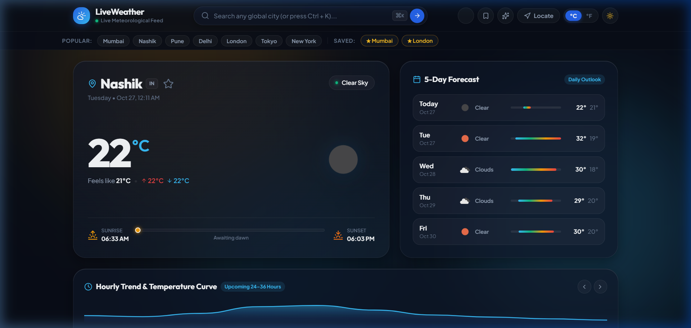
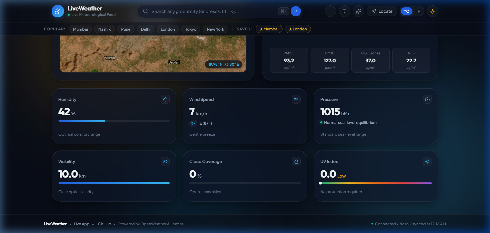
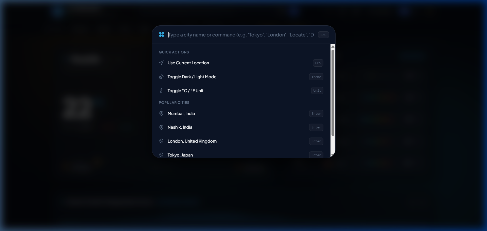
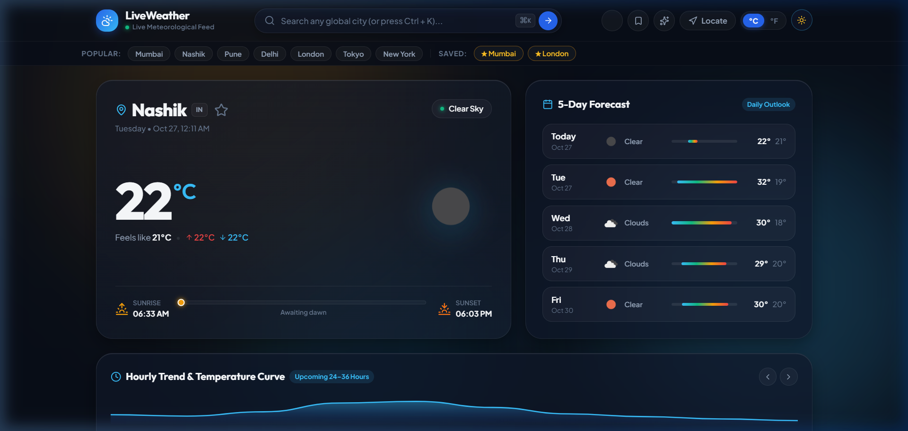

<div align="center">

  # 🌦️ LiveWeather
  ### **Advanced Meteorological Intelligence & Real-Time Planetary Telemetry**

  [](https://liveweather-one.vercel.app/)
  [](https://github.com/Arunsanap99/liveweather)
  [](https://opensource.org/licenses/MIT)

  <p align="center">
    <a href="https://liveweather-one.vercel.app/"><strong>Explore the Live Application »</strong></a>
    <br />
    <br />
    <a href="#-application-showcase">Showcase</a> •
    <a href="#-key-features">Key Features</a> •
    <a href="#-architecture--data-flow">Architecture</a> •
    <a href="#-command-palette--keyboard-shortcuts">Shortcuts</a> •
    <a href="#-quick-start-run-locally">Quick Start</a> •
    <a href="#-tech-stack--specifications">Tech Stack</a>
  </p>

  [](https://developer.mozilla.org/en-US/docs/Web/HTML)
  [](https://developer.mozilla.org/en-US/docs/Web/CSS)
  [](https://developer.mozilla.org/en-US/docs/Web/JavaScript)
  [](https://leafletjs.com/)
  [](https://openweathermap.org/api)
  [](https://liveweather-one.vercel.app/)

</div>

---

## 🧭 Overview

**LiveWeather** is a modern, high-performance meteorological dashboard engineered with **pure Vanilla web technologies** (HTML5, CSS3, and ES6+ JavaScript). It transforms raw meteorological data into an intuitive, visually stunning experience featuring **real-time particle physics**, **multi-layer satellite radar mapping**, **air quality intelligence**, and **predictive temperature curves**.

Designed with a sleek **cosmic dark aesthetic**, responsive **Bento Grid layout**, and **zero-dependency runtime**, LiveWeather delivers desktop-class performance across mobile, tablet, and widescreen displays.

> ⚡ **Zero Framework Overhead**: Built with 100% native Web Standards. No React, no Tailwind, no bundlers required. Fast initial paint with 60 FPS animations.

---

## 📸 Application Showcase

<div align="center">
  <h3>🌌 Cosmic Dark Dashboard (Real-Time Meteorological Telemetry)</h3>
  
</div>

<br/>

<p align="center">
  
  
</p>
<p align="center">
  <sub><strong>Left:</strong> Interactive Leaflet Satellite Radar & Air Quality Index &nbsp;•&nbsp; <strong>Right:</strong> Raycast-style floating Command Palette (<kbd>Ctrl</kbd> + <kbd>K</kbd>)</sub>
</p>

<br/>

<div align="center">
  <h3>☀️ Crisp Daylight Light Theme</h3>
  
</div>

---

## ✨ Key Features

### 🌌 1. Atmospheric Canvas Particle Engine
- Custom HTML5 2D canvas physics simulation running in the background.
- Dynamic condition mapping:
  - **🌧️ Rain**: Angled velocity streaks with ripple shockwaves upon hitting the viewport floor.
  - **❄️ Snow**: Gentle sinusoidal drifting snowflakes with authentic angular drag.
  - **⚡ Thunderstorm**: Particle cascades coupled with ambient lightning illumination bursts.
  - **☀️ Clear Sky**: Subtle floating golden dust motes responding to daylight cycles.
- One-click toggle in the header to pause particle physics for battery-saving mode.

### 🗺️ 2. Multi-Layer Geographic & Satellite Radar
- Fully responsive **Leaflet.js** map container with auto-centering beacon and real-time coordinates readout ($^{\circ}\text{N/S}, ^{\circ}\text{E/W}$).
- **4 Switchable High-Resolution Layers (Zero Watermarks)**:
  - 🛰️ **Satellite**: Esri World Imagery (high-altitude orbital photographic capture).
  - 🌘 **Dark Canvas**: Esri Dark Gray Base + Reference (sleek OLED aesthetic).
  - 🏙️ **Streets**: OpenStreetMap standard global vector cartography.
  - 📡 **Precipitation Radar**: Live radar overlay displaying rain bands and storm fronts.

### 🍃 3. Precision Air Quality Index (AQI)
- Ingests real-time atmospheric data from the **OpenWeather Air Pollution API**.
- Comprehensive breakdown of primary pollutant concentrations:
  - $\text{PM}_{2.5}$ & $\text{PM}_{10}$ (Fine particulate matter)
  - $\text{O}_3$ (Ground-level ozone)
  - $\text{NO}_2$ (Nitrogen dioxide)
- Segmented visual progress bar and health recommendations tailored to active readings.

### 📈 4. Cubic Bezier Temperature Trend Curve
- Mathematically generated dynamic **SVG cubic spline curve** connecting hourly forecast intervals.
- Soft gradient fill (`rgba(56, 189, 248, 0.25)`) visually projecting temperature shifts over the upcoming 24-hour cycle.

### ☀️ 5. Celestial Solar Arc & Daylight Clock
- Live calculation of sunrise, sunset, and daylight duration computed from the searched location's specific UTC timezone offset.
- Floating glowing sun orb tracking real-time position across the horizon curve.

### ⌨️ 6. Raycast-Style Command Palette (`Ctrl + K` / `⌘K`)
- Instant keyboard navigation dialog allowing users to:
  - Search any global city with immediate focus.
  - Trigger GPS geolocation detection.
  - Toggle between Metric (°C) and Imperial (°F) units.
  - Switch between Deep Cosmic Dark mode and Crisp Daylight Light mode.

### 📑 7. 5-Day Outlook with Dynamic Gradient Bars
- Apple Weather-style continuous gradient bars highlighting daily minimum and maximum temperature spans.
- Weather condition badges and weekday calendar breakdowns.

### 📊 8. Bento Grid Environmental Telemetry
- **Rotating Wind Compass**: 360° directional arrow calibrated to cardinal headings (N, NE, E, SE, S, SW, W, NW).
- **Humidity Gauge**: Percentage tracking with comfort zone metrics.
- **Barometric Pressure**: Atmospheric pressure monitoring in hPa.
- **Optical Visibility**: Distance visibility range in km / miles.
- **Cloud Coverage**: Cloud density percentage.
- **UV Exposure Index**: Real-time solar ultraviolet radiation calculation.

---

## 🏛️ Architecture & Data Flow

```
[ User Input / Geolocation ]
            │
            ▼
┌──────────────────────────────────────┐
│       LiveWeather Core Engine        │
│             (script.js)              │
└──────────────────┬───────────────────┘
                   │
         ┌─────────┴─────────┐
         ▼                   ▼
┌──────────────────┐ ┌───────────────────┐
│ OpenWeather API  │ │ Leaflet & Tiles   │
│  - Current       │ │  - Esri Satellite │
│  - 5-Day Forecast│ │  - Esri Dark      │
│  - Air Pollution │ │  - OpenStreetMap  │
└────────┬─────────┘ └─────────┬─────────┘
         │                     │
         └─────────┬───────────┘
                   ▼
┌──────────────────────────────────────┐
│     Reactive State Commit Layer      │
│  (appState: units, theme, favorites) │
└──────────────────┬───────────────────┘
                   │
  ┌────────────────┼────────────────┬────────────────┐
  ▼                ▼                ▼                ▼
[ Canvas 2D ]    [ SVG Spline ]   [ Leaflet Map ]  [ Bento UI Cards ]
 Particle Sim     Bezier Curve     Pulsed Beacon    Live DOM Metrics
```

---

## ⌨️ Command Palette & Keyboard Shortcuts

| Shortcut | Action | Description |
| :--- | :--- | :--- |
| <kbd>Ctrl</kbd> + <kbd>K</kbd> / <kbd>⌘</kbd> + <kbd>K</kbd> | **Open Command Palette** | Floating search dialog for cities and quick commands |
| <kbd>/</kbd> | **Focus Search Bar** | Instantly highlights the primary navbar search input |
| <kbd>Esc</kbd> | **Dismiss / Close** | Closes Command Palette or clears current input |
| <kbd>Enter</kbd> | **Submit City** | Queries OpenWeather API for entered location |

---

## 🛠️ Tech Stack & Specifications

- **Markup**: Semantic HTML5 with complete ARIA role tags and accessibility attributes.
- **Styling**: Vanilla CSS3 with:
  - CSS Custom Properties (Design Tokens)
  - Glassmorphic card backdrops (`backdrop-filter: blur(16px)`)
  - Fluid Bento Grid system using CSS Grid and Flexbox
  - Micro-animations and GPU-accelerated CSS transitions
- **Client Logic**: Vanilla JavaScript ES6+ (Native `fetch`, `async/await`, Canvas API, SVG Path interpolation).
- **Mapping Engine**: [Leaflet.js 1.9.4](https://leafletjs.com/) with Esri ArcGIS World Services & OpenStreetMap.
- **Iconography**: [Lucide Icons](https://lucide.dev/) (lightweight, crisp vector symbols).
- **Typography**: Google Fonts ([Outfit](https://fonts.google.com/specimen/Outfit) for numerical data, [Plus Jakarta Sans](https://fonts.google.com/specimen/Plus+Jakarta+Sans) for interface copy).
- **Hosting**: [Vercel](https://vercel.com/) Global Edge Network.

---

## 📂 Repository Directory Structure

```text
liveweather/
├── index.html          # Semantic layout, Bento Grid markup, modals, canvas container
├── style.css           # Design tokens, glassmorphism, responsive media queries, themes
├── script.js           # Weather telemetry engine, Canvas physics, Leaflet map controller
├── config.example.js   # Configuration template for custom OpenWeather API keys
├── .gitignore          # Exclusion rules for local configuration and secrets
└── README.md           # Modern documentation, architecture guide & feature index
```

---

## 🚀 Quick Start (Run Locally)

Since LiveWeather is built purely with native web standards, you can run it immediately without `npm install` or complex build pipelines.

### Option 1: Python HTTP Server (Recommended)
```bash
# Clone the repository
git clone https://github.com/Arunsanap99/liveweather.git

# Navigate to project directory
cd liveweather

# Start local server (Python 3.x)
python -m http.server 5173
```
Visit **[http://localhost:5173](http://localhost:5173)** in your browser.

### Option 2: Node.js `npx serve`
```bash
npx serve .
```

### Option 3: VS Code Live Server
1. Open the project folder in VS Code.
2. Install the **Live Server** extension.
3. Right-click `index.html` and select **"Open with Live Server"**.

---

## ⚙️ Configuration & API Keys

LiveWeather comes with a verified pre-configured key for instant out-of-the-box operation. To use your own custom key:

1. Sign up for a free key at [OpenWeather API Keys](https://home.openweathermap.org/api_keys).
2. Copy `config.example.js` to `config.js`:
   ```javascript
   window.ENV_CONFIG = {
     apiKey: "YOUR_OPENWEATHER_API_KEY_HERE",
     cartoApiKey: "" // Optional
   };
   ```
3. `config.js` is automatically excluded from git by `.gitignore` to keep your credentials safe.

---

## 🌐 Production Deployment

Deploy your own instance of LiveWeather in seconds to any static host:

| Platform | Deployment Instructions |
| :--- | :--- |
| **Vercel** | Import your GitHub repo at [vercel.com/new](https://vercel.com/new), select **Other** framework, and click **Deploy**. |
| **Netlify** | Drag and drop the project folder or link your repository to deploy instantly. |
| **GitHub Pages** | Go to **Settings > Pages > Build and deployment**, select `main` branch, and save. |

---

## 👨‍💻 Author

**Arun Sanap**  
- **Live Deployment**: [https://liveweather-one.vercel.app/](https://liveweather-one.vercel.app/)  
- **GitHub**: [@Arunsanap99](https://github.com/Arunsanap99)  
- **Repository**: [https://github.com/Arunsanap99/liveweather](https://github.com/Arunsanap99/liveweather)

---

## 📄 License

This project is open-source and distributed under the **[MIT License](LICENSE)**. Feel free to fork, customize, and build upon it!

<div align="center">
  <sub>Built with ❤️ using pure HTML5, CSS3, and Vanilla JavaScript.</sub>
</div>
